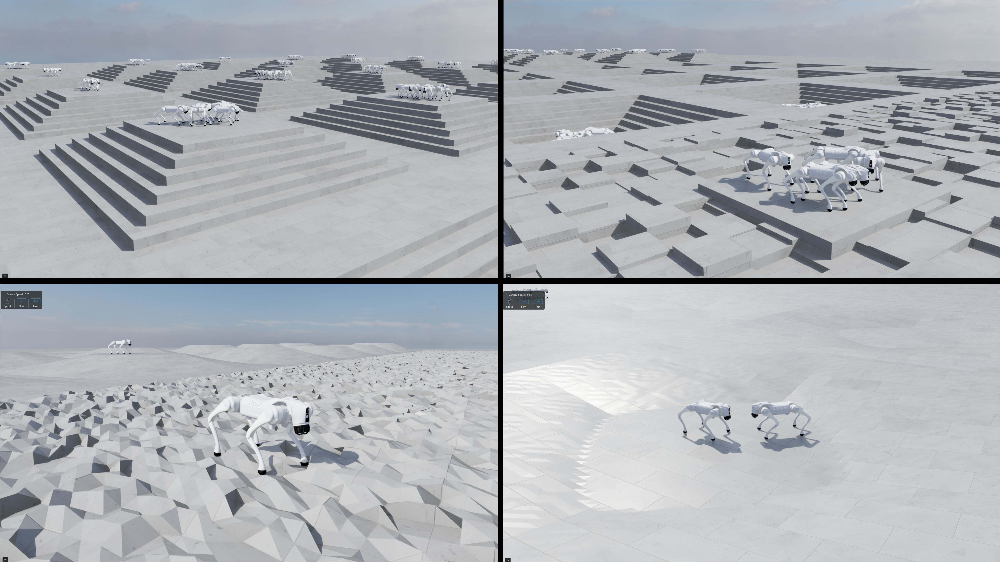
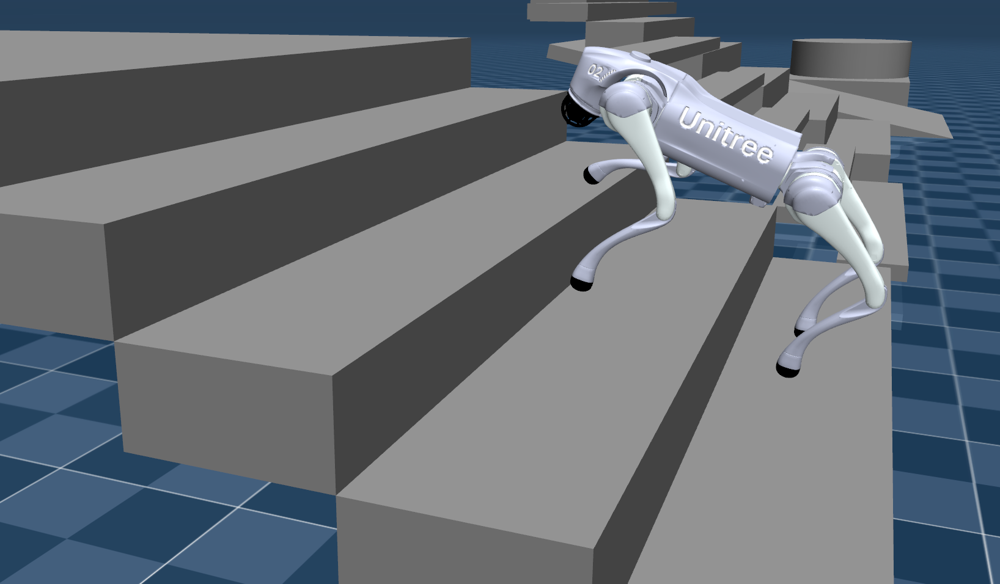

# Unitree Go2 RL

Research framework for reinforcement learning, autonomous locomotion, and sim-to-sim evaluation of the Unitree Go2 quadruped robot.

The project integrates the main components of the experimental stack as Git submodules. The repository is intended to provide a reproducible environment for development, training, evaluation, and analysis of locomotion controllers.

This version of the project provides a framework for conducting experiments on observation-space design using Actor-Critic PPO (RSL-RL) as the primary reinforcement learning algorithm. It allows users to build and train locomotion policies, experiment with domain randomization, and validate the resulting controllers through sim-to-sim and sim-to-real transfer.

<p align="center">
  
</p>

> [!WARNING]
> **Sim-to-real safety.** Exercise extreme caution when performing sim-to-real transfer of locomotion controllers. Improperly selected domain-randomization parameters can result in unstable or unsafe robot behavior and may cause **serious damage to the robot or its surroundings**.
>
> **Always perform thorough sim-to-sim validation before attempting to deploy a controller on the physical robot.** Never deploy an unvalidated controller directly to a real robot.

---

## Project Structure

```text
unitree-go2-rl/
├── IsaacLab/                 # Training simulator and RL environment
├── docs/                     # Setup and usage documentation
├── ros2_ws/                  # ROS 2 Humble workspace
│   └── src/
│       ├── go2_policy_runner/    # Policy controller for MuJoCo and the real robot
│       ├── go2_eval/             # Policy evaluation in MuJoCo, sim-to-sim comparison
│       └── unitree -> ../../unitree_ros2/cyclonedds_ws/src/unitree   # Unitree message packages
├── unitree_rl_lab/           # Reinforcement learning framework and training configurations
├── unitree_mujoco/           # MuJoCo simulation and sim-to-sim evaluation
├── unitree_ros/              # ROS integration and urdf source
├── unitree_ros2/             # ROS 2 integration
├── unitree_sdk2/             # C++ SDK
├── unitree_sdk2_python/      # Python SDK
└── unitree_metrics/          # Training metrics analysis and visualization
```

## Components

| Component           | Purpose                                                            |
| ------------------- | ------------------------------------------------------------------ |
| IsaacLab (v2.3.0)   | Training simulator and RL environment                              |
| unitree_rl_lab      | RL training framework and locomotion configurations                |
| unitree_mujoco      | MuJoCo simulation and sim-to-sim evaluation                        |
| go2_policy_runner   | ROS 2 controller running trained policies in MuJoCo and on the Go2 |
| go2_eval            | Policy evaluation in MuJoCo on the IsaacLab scenarios (sim-to-sim) |
| unitree_ros         | ROS integration and urdf source                                    |
| unitree_ros2        | ROS 2 integration and Unitree message definitions                  |
| unitree_sdk2        | C++ SDK for Unitree robots                                         |
| unitree_sdk2_python | Python SDK for Unitree robots                                      |
| unitree_metrics     | Training metrics analysis and visualization                        |

## Repository Organization

The repositories listed above are included as Git submodules. `go2_policy_runner` is located inside the ROS 2 workspace at `ros2_ws/src/go2_policy_runner`. `go2_eval` is part of this repository (`ros2_ws/src/go2_eval`).

The main repository records the exact commit of each submodule used by the project. This makes it possible to reproduce a known project state even when the individual component repositories continue to evolve.

The branches specified in `.gitmodules` are used for convenient development and updates, while the commit recorded by the main repository determines the exact version used in a particular revision.

## Usage

### Cloning

Clone the complete project together with all submodules:

```bash
git clone --recurse-submodules git@github.com:pavelmino44/unitree-go2-rl.git
```

If the repository has already been cloned without submodules:

```bash
git submodule update --init --recursive
```

## Documentation

Setup, usage, and component documentation: [docs/README.md](docs/README.md).

## What's New

The project now has reproducible policy tests and a quantitative sim-to-sim transferability assessment:

* **[go2_policy_runner](https://github.com/pavelmino44/go2_policy_runner)** — a ROS 2 controller that runs the trained ONNX policy through the same pipeline in MuJoCo and on the real Go2, with passive / stand / walk modes and command limits taken from the training configuration.
* **[Evaluation in unitree_rl_lab](https://github.com/pavelmino44/unitree_rl_lab/blob/pavel/go2-modifications/doc/Evaluation_en.md)** — a fixed set of test scenarios (one obstacle per scenario: flat, slopes, stairs, boxes, rough terrain), per-episode metrics, reports and a GUI for evaluating policies in IsaacLab.
* **IsaacLab terrains in MuJoCo** — the evaluation terrains are exported from `unitree_rl_lab` and rebuilt as MuJoCo scenes in `unitree_mujoco`, so both simulators test the policy on the same geometry.
* **[go2_eval](ros2_ws/src/go2_eval/README.md)** — runs the same scenarios in MuJoCo through `go2_policy_runner`, computes the same metrics, and compares IsaacLab and MuJoCo results side by side (`eval_compare`) to measure sim-to-sim transferability.

## Development Status

The project is under active development.

The current stack is focused on:

* reinforcement learning for quadruped locomotion;
* Unitree Go2 velocity control;
* training in IsaacLab;
* sim-to-sim evaluation in MuJoCo;
* ROS 2 policy deployment with identical simulation and real-robot pipelines;
* ROS 2 and Unitree SDK integration;
* analysis and visualization of training metrics.

Work in progress:

* LiDAR simulation;
* training of exteroceptive locomotion policies.

Installation and experiment-specific instructions are being documented as the project develops.

<p align="center">
 
</p>

---

## License

The files of this repository (documentation, top-level configuration and the `go2_eval` package) are licensed under the [Apache License 2.0](LICENSE). The software is provided "as is", without warranty of any kind.

The submodules are separate works. Each keeps its own license and copyright notices, and the LICENSE of this repository does not apply to them:

| Component | License |
|---|---|
| IsaacLab | BSD-3-Clause (`isaaclab_mimic`: Apache-2.0) |
| unitree_rl_lab | Apache-2.0 |
| unitree_mujoco | BSD-3-Clause |
| unitree_ros | BSD-3-Clause |
| unitree_ros2 | BSD-3-Clause |
| unitree_sdk2 | BSD-3-Clause |
| unitree_sdk2_python | BSD-3-Clause |
| go2_policy_runner | Apache-2.0 |
| unitree_metrics | MIT |
| go2_eval (this repository) | Apache-2.0 |

`go2_eval` contains code derived from unitree_rl_lab. Each derived file keeps a header that lists the upstream files and the changes made. See [NOTICE](NOTICE) and [THIRD_PARTY_NOTICES.md](THIRD_PARTY_NOTICES.md) for copyright holders, derived files and software that is installed separately.

This project is not affiliated with, endorsed by, or sponsored by Unitree Robotics or NVIDIA. "Unitree", "Go2", "Isaac Sim" and "Isaac Lab" are used only to describe compatibility.
