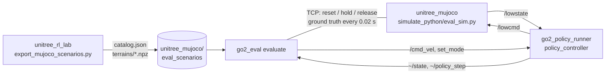

# go2_eval

Sim-to-sim evaluation of Go2 locomotion policies in **MuJoCo**, on exactly the same fixed scenarios as
`unitree_rl_lab/scripts/rsl_rl/evaluate.py` (IsaacLab), through the deployment stack
(`go2_policy_runner` + `unitree_mujoco`).

- **Same scenarios.** Every scenario of `eval_scenarios.py` (flat walks, turn, sprint and stop, every
  sub-terrain of `ROUGH_TERRAINS_CFG` with its difficulty levels and stair/slope sweeps, `slope_up_*`)
  is exported from IsaacLab, including the exact terrain tile that IsaacLab generates for it.
- **Same terrains.** Each tile is rebuilt in MuJoCo from the IsaacLab triangles. Stairs, pits, random
  blocks and flat ground become boxes and match exactly. Slopes become a height field that also
  matches exactly. Random rough ground becomes a height field on a 2 cm grid: about 1 mm mean
  error, but its vertical walls turn into 2 cm ramps. All tiles get the same 20 m border as IsaacLab.
- **Same episodes.** The spawn pose, initial joint positions, command, heading hold, command
  schedule, episode length and end conditions (goal line / full turn, time out, base contact, bad
  orientation) all match IsaacLab.
- **Same metrics and report.** Per-step rows, contact events, sprint metrics, summaries and terminal
  tables are a verbatim copy of `evaluate.py` (`metrics.py`). The JSON report has the same format,
  so `eval_report.py` (copied from `unitree_rl_lab`) draws the same windows for both simulators.
- **Comparison.** `eval_compare` puts an IsaacLab report and a MuJoCo report side by side.
- **GUI.** `evaluate --gui` opens the same window as `evaluate.py --gui`.

## How it works



- `eval_sim.py` is the `unitree_mujoco.py` simulator: same `go2.xml`, same `SIMULATE_DT`, same
  `UnitreeSdk2Bridge`. It adds the scenario scene, a control connection and the ground truth (base
  pose and velocity, joint torques, contact forces of base / head / legs). One process is started
  per (scenario, seed), as in `evaluate.py`.
- `go2_policy_runner` is launched once (`input:=none`) and runs the exported policy exactly as on
  the robot.
- Every episode: the base is held at the spawn pose and the controller goes to `stand`
  (`--stand_time`, 3 s). Then the base is released and the controller is switched to `walk` at
  t = 0. The command is published on `/cmd_vel` every control step until an end condition.

## Usage

### 1. Export the scenarios (IsaacLab conda env, in `unitree_rl_lab`)

```bash
python scripts/rsl_rl/export_mujoco_scenarios.py --headless --eval_seed 42,43,44
# -> ../unitree_mujoco/eval_scenarios/catalog.json + terrains/*.npz (~1 MB per seed)
```

Re-run it after changing `eval_scenarios.py`, `ROUGH_TERRAINS_CFG`, the commands or the terminations.
`--append` adds scenarios or seeds to an existing catalog.

Check the scenes (venv with mujoco):

```bash
cd unitree_mujoco/simulate_python
python eval_scene.py ../eval_scenarios/catalog.json all --check        # height error vs. IsaacLab
python eval_scene.py ../eval_scenarios/catalog.json rough_pyramid_stairs_15cm --view
```

### 2. Build

`go2_eval` sits next to `go2_policy_runner` in `ros2_ws/src`:

```bash
cd ros2_ws && colcon build --packages-select go2_eval && source install/setup.bash
```

### 3. Run

```bash
ros2 run go2_eval evaluate --gui
ros2 run go2_eval evaluate --policy_dir ~/unitree-go2-rl/unitree_rl_lab/logs/rsl_rl/unitree_go2_velocity \
    --scenarios rough_pyramid_stairs_10cm --viewer
ros2 run go2_eval evaluate --policy_dir <run> --scenarios rough --eval_seed 42,43,44 --episodes 3
ros2 run go2_eval evaluate --list
```

The simulator needs `mujoco` and `unitree_sdk2py`. It runs with `--sim_python`, which defaults to
`~/unitree_env/bin/python3` if that exists and otherwise to the current Python. The catalog is
found upwards from the current directory (`unitree_mujoco/eval_scenarios/catalog.json`), or given
with `--catalog`.

The arguments are the same as in `evaluate.py`: `--scenarios` (names, globs, `rough`, `all`),
`--episodes`, `--eval_seed`, `--speed`, `--no_contact_termination`, `--record_dt`, `--output`,
`--no_report`, `--report_save`. MuJoCo-specific arguments:

| Argument | Default | Description |
|---|---|---|
| `--policy_dir` | | Policy for go2_policy_runner: a run folder, or `logs/rsl_rl/<experiment>` (latest run) |
| `--viewer` | off | MuJoCo window (camera follows the robot; start, top and goal lines are drawn) |
| `--network_interface`, `--domain_id` | `lo`, `0` | DDS of the simulator and the controller |
| `--stand_time` | 3.0 | Seconds in `stand` before each episode. Must cover the stand sequence (2.5 s from `passive`) |
| `--sim_python` | see above | Python with mujoco + unitree_sdk2py |
| `--sim_args` | | Extra arguments for `eval_sim.py`, e.g. `'--dt 0.002 --hfield_resolution 0.01'` |
| `--runner_config` | its `go2.yaml` | Parameter file of go2_policy_runner |
| `--no_launch_runner` | off | Use a controller that is already running (started with `input:=none`) |
| `--log_dir` | temp | Logs of the simulator runs and the controller |

The report goes to `<policy run>/eval/mujoco_eval_<time>.json`.

### 4. Look and compare

```bash
ros2 run go2_eval eval_report <mujoco report>.json         # the same windows as unitree_rl_lab eval_report.py
ros2 run go2_eval eval_compare <isaac report>.json <mujoco report>.json [--save [DIR]]
```

`--save` writes the figures (`sim_to_sim.png`: per scenario and sweeps, `metrics.png`: one bar panel per metric with every episode as a dot) and the printed tables (`compare.txt`) into DIR; without
DIR into `sim-to-sim_compare_<date>/` next to the MuJoCo report (the `eval/` folder of the policy run).
Without a display the results are always saved there.

`eval_compare` prints IsaacLab | MuJoCo for every common scenario: success, falls, speed, tracking,
path, power, CoT, tilt and contacts. It also prints the mean differences and the largest success
gaps. It draws one figure: per-scenario bars and the stairs / slope / blocks sweeps of both
simulators.

## Differences from IsaacLab

These are part of what sim-to-sim measures:

- **Real time.** The controller runs on the wall clock, so episodes run in real time and repeated
  runs differ slightly. Use several episodes. Each episode records `mujoco.real_time_factor` and
  `min_lowstate_rate_hz`. If the factor drops below about 0.95, the PC was too slow for that run.
- **No rewards.** Reward terms need the IsaacLab managers, so `total_reward` is empty.
- **Contacts.** The contacts come from the collision geoms of `go2.xml`. The head is the front
  geoms of `base_link`; the legs are hip, thigh and calf without the foot sphere. The force
  threshold is that of the training termination (1 N).
- **Pipeline.** The policy runs through go2_policy_runner and the DDS bridge, which apply PD on
  every received lowcmd, not inside physics as IsaacLab does. This difference is part of the
  measurement.
- **Extra end reason.** If the controller leaves `walk` by itself (its safety layer), the episode
  ends with `controller_<mode>`.
- **Seeds.** The seed selects the terrain realization of `boxes` and `random_rough`. It matches
  IsaacLab when the export ran on the same machine as `evaluate.py`; the box heights are drawn on
  the GPU when one is present.

When `evaluate.py` changes, copy `metrics.py` and `eval_report.py` from it again (see the header of
`metrics.py`).